# Mockups: games 11 to 20

How each game should look. Compare with the app after `./gradlew :<module>:installDebug` and ask for changes against these pictures.

The home screen, level map, daily puzzle, streak rewards, themes, settings and win screen come from `core` and are the same as in games 1 to 10.

| # | Game | Module | Home | Playing |
|---|---|---|---|---|
| 11 | Sun & Moon | `sun-moon` | 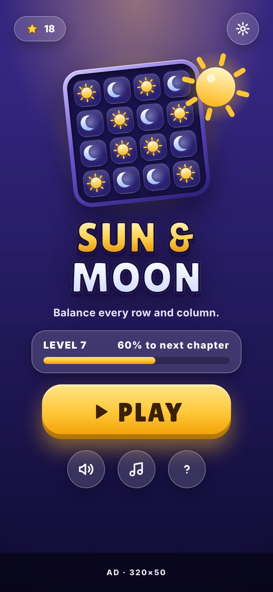 | 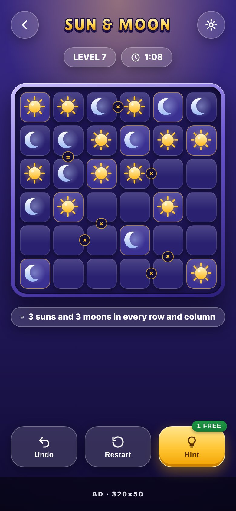 |
| 12 | Number Path | `number-path` | 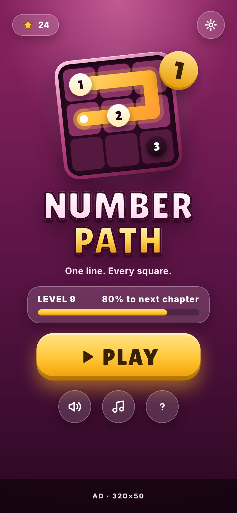 | 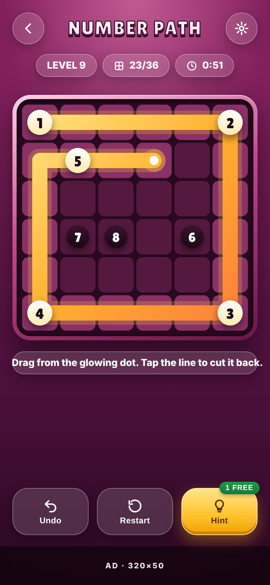 |
| 13 | Nonogram | `nonogram` | 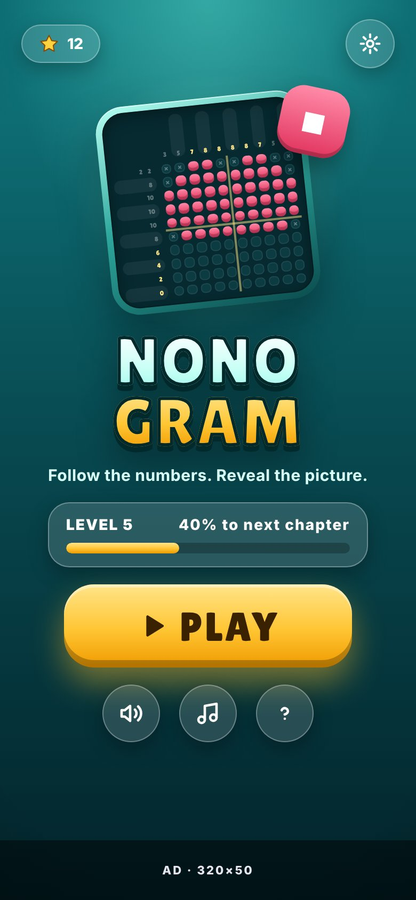 | 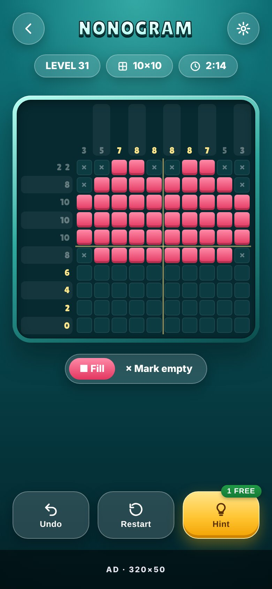 |
| 14 | Rectangles | `rectangles` | 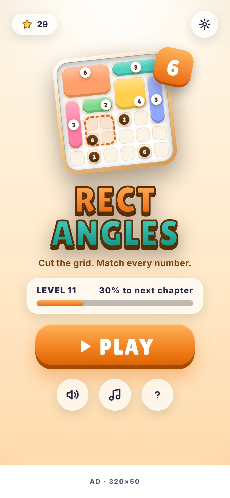 | 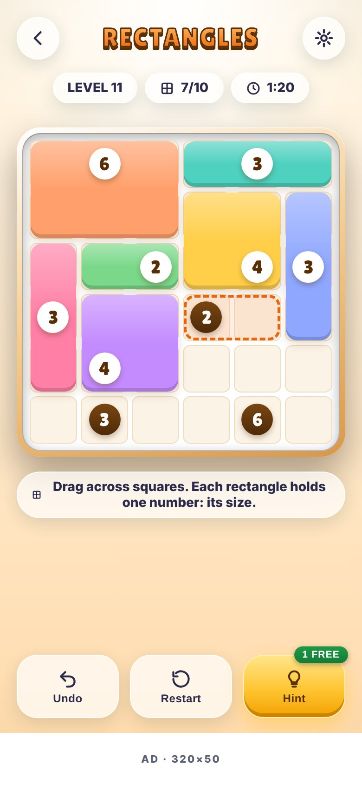 |
| 15 | Number Match | `number-match` | 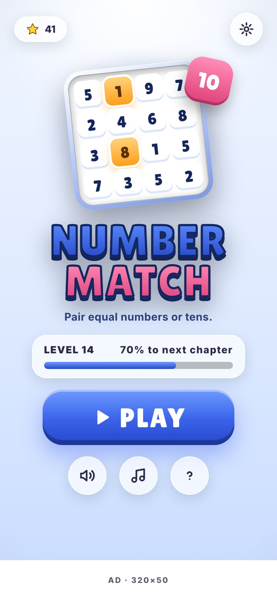 | 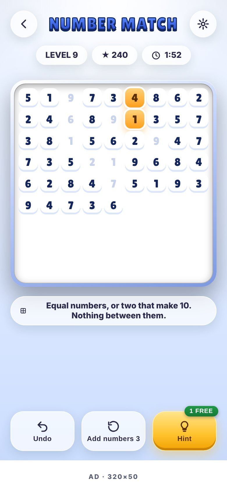 |
| 16 | Cryptogram | `cryptogram` | 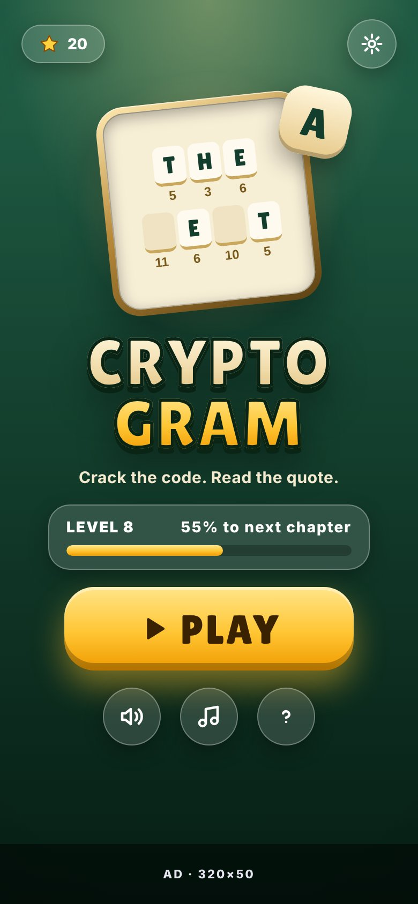 | 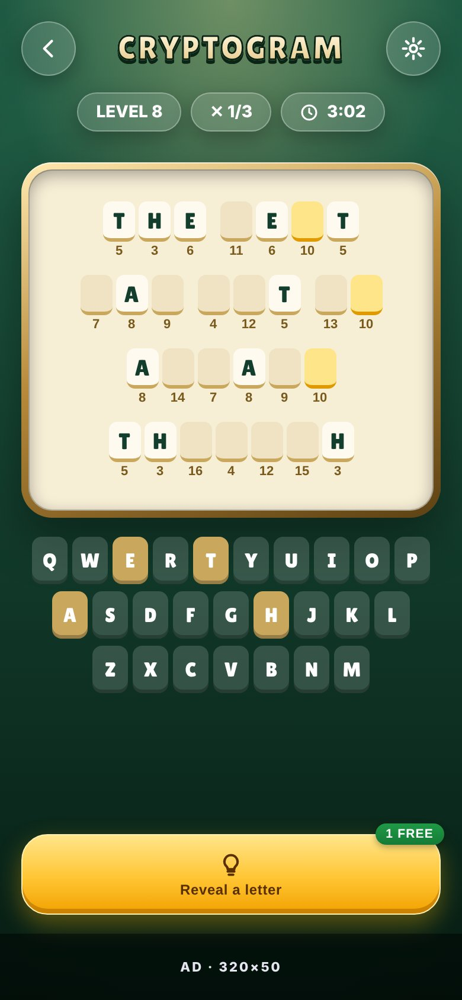 |
| 17 | Five Letters | `five-letters` | 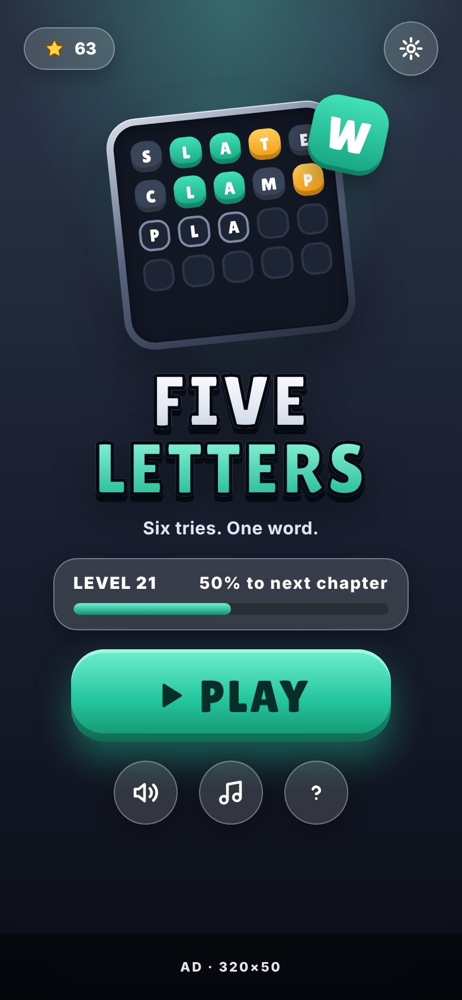 | 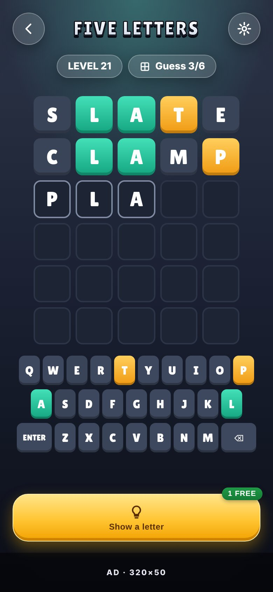 |
| 18 | Word Groups | `word-groups` | 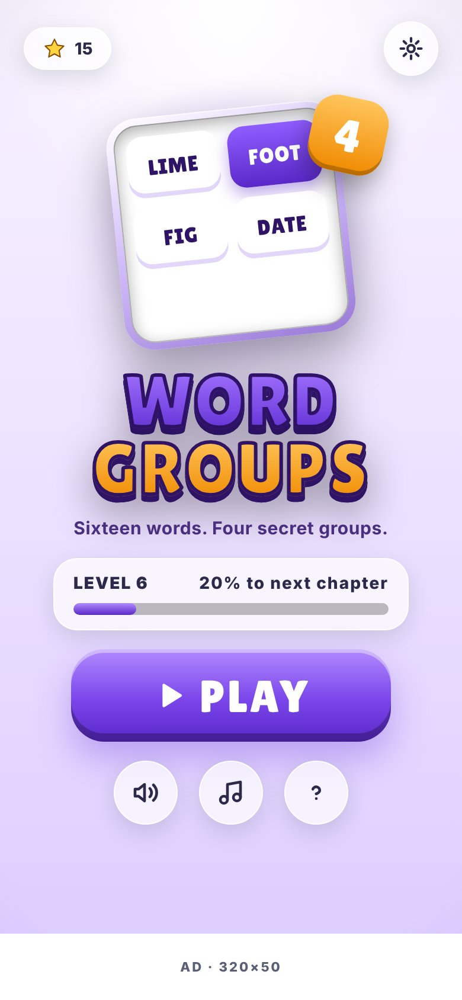 | 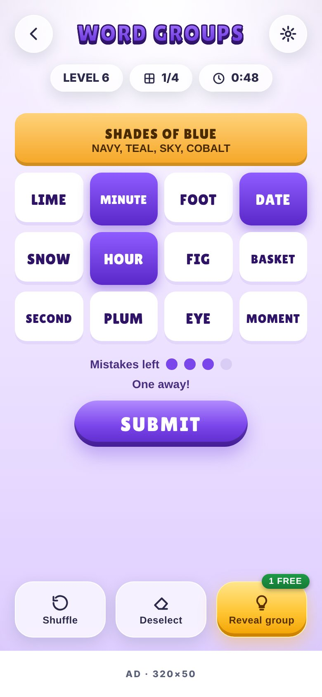 |
| 19 | Domino Logic | `domino-logic` | 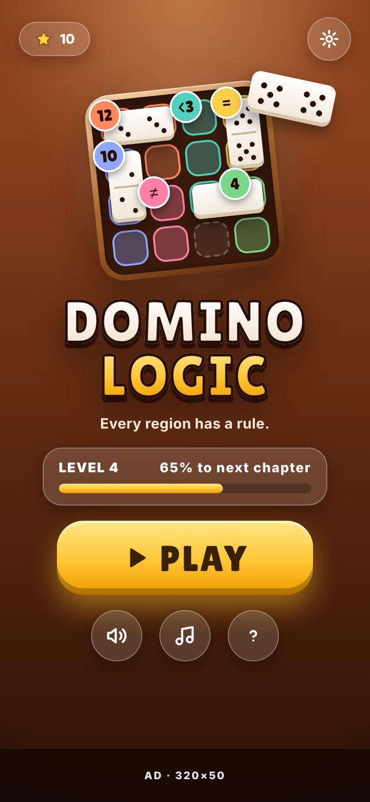 | 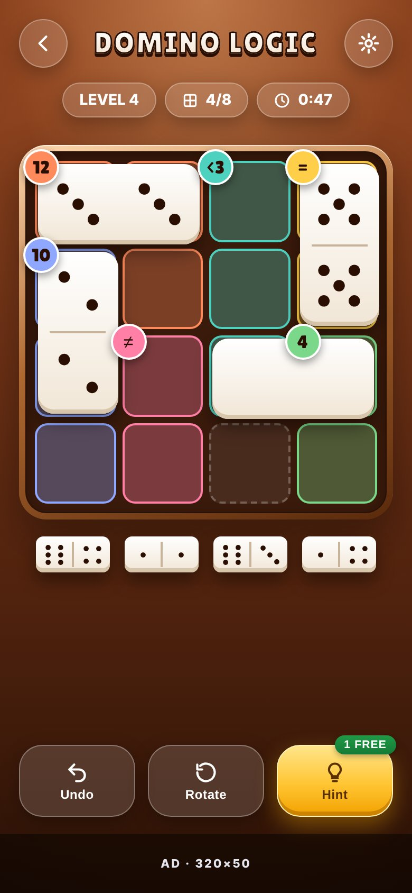 |
| 20 | Bridges | `bridges` | 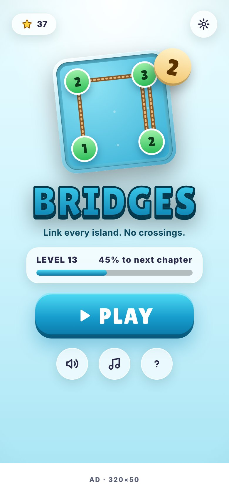 | 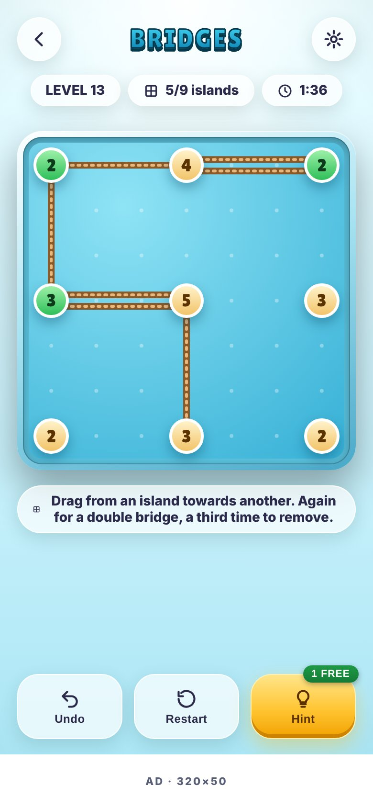 |

These are drawings, not screenshots: small details (exact numbers, spacing, body font) differ from the running app.
